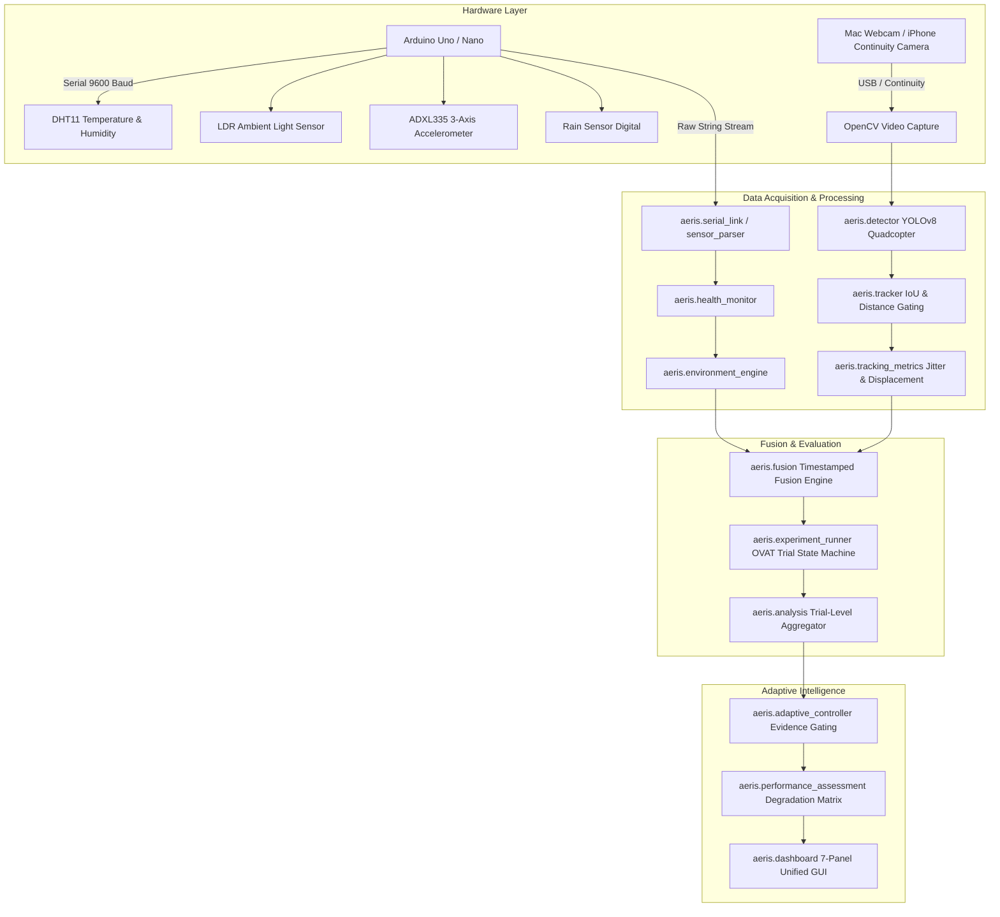

# AERIS-X: Adaptive Environmental Resilience & Intelligent Sensing

[](https://www.python.org/downloads/)
[](https://opensource.org/licenses/MIT)
[](https://www.sih.gov.in/)
[](https://github.com/ultralytics/ultralytics)
[](https://opencv.org/)
[](tests/)

> **A Low-Budget Hardware & Software Prototype for Smart India Hackathon (SIH 2026)**  
> **Problem Statement PS 26050**: *"High Altitude Performance Optimization and Robust Design of Anti-Drone System"*

---

## Table of Contents
- [1. Overview & Motivation](#1-overview--motivation)
- [2. System Architecture](#2-system-architecture)
- [3. Hardware Bill of Materials (BOM) & Pinout](#3-hardware-bill-of-materials-bom--pinout)
- [4. Installation & Quickstart](#4-installation--quickstart)
- [5. Camera Setup & Discovery](#5-camera-setup--discovery)
- [6. Sensor Baseline Calibration](#6-sensor-baseline-calibration)
- [7. Complete 12-Phase Implementation Roadmap](#7-complete-12-phase-implementation-roadmap)
  - [Phase 1: Sensor Foundation & Serial Link](#phase-1-sensor-foundation--serial-link)
  - [Phase 2: Environmental Intelligence Engine](#phase-2-environmental-intelligence-engine)
  - [Phase 3: Camera Acquisition Layer](#phase-3-camera-acquisition-layer)
  - [Phase 4: Real-time YOLOv8 Quadcopter Detection](#phase-4-real-time-yolov8-quadcopter-detection)
  - [Phase 5: Target Selection & Visual Tracking](#phase-5-target-selection--visual-tracking)
  - [Phase 6: Tracking Metrics Engine](#phase-6-tracking-metrics-engine)
  - [Phase 7: Timestamped Sensor & Vision Fusion](#phase-7-timestamped-sensor--vision-fusion)
  - [Phase 8: Controlled OVAT Experimental Framework](#phase-8-controlled-ovat-experimental-framework)
  - [Phase 9: Trial-Level Statistical Aggregation](#phase-9-trial-level-statistical-aggregation)
  - [Phase 10: Evidence-Gated Software Tracking Adaptation](#phase-10-evidence-gated-software-tracking-adaptation)
  - [Phase 11: Performance & Degradation Assessment](#phase-11-performance--degradation-assessment)
  - [Phase 12: Integrated Demonstration Dashboard](#phase-12-integrated-demonstration-dashboard)
- [8. Model Information & Class Mapping](#8-model-information--class-mapping)
- [9. Running the Test Suite](#9-running-the-test-suite)
- [10. Scientific Rigor & Confounder Disclaimers](#10-scientific-rigor--confounder-disclaimers)
- [11. Repository Structure](#11-repository-structure)
- [12. License & Citation](#12-license--citation)

---

## 1. Overview & Motivation

Anti-drone and aerial surveillance systems deployed at high altitudes or in border environments face extreme environmental stressors:
- **Low Ambient Temperatures & Thermal Shocks** that cause optical drift and sensor variance.
- **High-Velocity Winds & Severe Vibration** that induce video jitter, motion blur, and frame displacement.
- **Sudden Low-Light, Fog, & Precipitation (Rain/Snow)** that obscure targets and degrade optical detection confidence.

**AERIS-X** bridges low-cost embedded environmental sensing with computer vision. Rather than treating drone detection as a purely visual problem, AERIS-X synchronizes real-time atmospheric readings (temperature, humidity, ambient light, 3-axis vibration, precipitation) with visual tracking metrics. 

When environmental degradation is detected, the system applies **evidence-gated software tracking adaptations** (such as vibration-damping filters, adaptive IoU thresholds, and contrast enhancements) to preserve target track continuity without requiring expensive mechanical gimbals.

---

## 2. System Architecture



---

## 3. Hardware Bill of Materials (BOM) & IoT Sensor Suite

The physical prototype uses low-budget, commercially off-the-shelf (COTS) embedded sensors connected to an **Arduino Uno R3 / Nano (ATmega328P)** flashed with [`aeris_firmware.ino`](aeris_firmware.ino). 

### 3.1 Component Pinout & Wiring Table

| Component | Sensor Module Pin | Microcontroller Pin | Interface Type | Operating Voltage | Measurement Range |
| :--- | :--- | :--- | :--- | :--- | :--- |
| **DHT11** | DATA / OUT | `D2` | 1-Wire Digital (Custom Bitbang) | 3.3V – 5.0V DC | 0°C to 50°C (±2°C), 20% to 90% RH (±5%) |
| **Rain Sensor Module** | DO (Digital Out) | `D3` | Digital GPIO (Active-Low) | 3.3V – 5.0V DC | Binary (0 = Water Present, 1 = Dry) |
| **LDR (Photoresistor)** | AO (Analog Out) | `A0` | 10-bit Analog ADC (0–1023) | 3.3V – 5.0V DC | Ambient Lux (0 = Dark, 1023 = Full Saturation) |
| **ADXL335 (X-Axis)** | X-OUT | `A1` | 10-bit Analog ADC (0–1023) | 3.0V – 3.6V DC (5V tolerant) | $\pm 3g$ full-scale lateral acceleration |
| **ADXL335 (Y-Axis)** | Y-OUT | `A2` | 10-bit Analog ADC (0–1023) | 3.0V – 3.6V DC (5V tolerant) | $\pm 3g$ full-scale longitudinal acceleration |
| **ADXL335 (Z-Axis)** | Z-OUT | `A3` | 10-bit Analog ADC (0–1023) | 3.0V – 3.6V DC (5V tolerant) | $\pm 3g$ full-scale vertical / gravitational vector |
| **Common Rail** | VCC | `5V` (or 3.3V) | DC Power Rail | Regulated | Stable system supply |
| **Common Rail** | GND | `GND` | Common Ground Reference | 0V | Unified ground plane |

---

### 3.2 Technical Breakdown of IoT Sensors & High-Altitude Relevance

Each sensor in AERIS-X addresses a specific physical failure mode encountered by anti-drone optical systems deployed at high altitudes or in harsh perimeter environments:

#### 1. DHT11 — Ambient Temperature & Relative Humidity Sensor
* **Sensing Technology:** NTC thermistor for temperature; resistive humidity sensing component.
* **Microcontroller Handling:** Read at ~10 Hz via single-wire digital interface. If sensor read returns `NaN` (due to bus timing jitter or power fluctuation), the firmware automatically substitutes `-999.0` so the Python parser can cleanly drop corrupted packets without crashing.
* **High-Altitude Role:** High-altitude mountain outposts experience severe sub-zero thermal extremes and rapid temperature swings. Extreme cold causes optical lens contraction, focal plane drift, and electronic component noise. Detecting temperature anomalies triggers thermal baseline offsets in the software tracking engine.

#### 2. ADXL335 — 3-Axis Precision Analog Accelerometer (Vibration Index)
* **Sensing Technology:** Triple-axis capacitive MEMS accelerometer with polysilicon surface-micromachined sensors and signal conditioning.
* **Microcontroller Handling:** Analog X, Y, and Z axes are sampled through the 10-bit ADC without hardcoded assumptions about 0g bias levels (which vary with orientation).
* **Python Vector Computation:** The system computes the true 3D Euclidean magnitude relative to the stationary baseline $(\bar{B}_x, \bar{B}_y, \bar{B}_z)$ calibrated via [`calibrate.py`](calibrate.py):
  $$\text{Vibration Index} = \sqrt{(A_x - \bar{B}_x)^2 + (A_y - \bar{B}_y)^2 + (A_z - \bar{B}_z)^2}$$
* **High-Altitude Role:** Mountainous terrain produces severe wind gusts and mechanical mast buffeting. High-frequency vibration induces severe optical motion blur and erratic frame-to-frame displacement. When the Vibration Index exceeds configured thresholds (e.g. $5.0\times$ baseline), the system triggers the `VIBRATION_SMOOTHING` software tracking adaptation.

#### 3. LDR (Light-Dependent Resistor) — Ambient Illumination Module
* **Sensing Technology:** Cadmium Sulfide (CdS) photoresistor in a voltage divider circuit with onboard LM393 comparator.
* **Microcontroller Handling:** Continuously samples ambient illumination as an analog integer between 0 and 1023.
* **Python Ratio Computation:** Rather than guessing absolute lux values, AERIS-X computes a dynamic **Light Ratio** relative to the calibrated ambient baseline:
  $$\text{Light Ratio} = \frac{\text{LDR}_{\text{current}}}{\bar{\text{LDR}}_{\text{baseline}}}$$
* **High-Altitude Role:** High altitudes experience abrupt lighting transitions caused by rapid cloud cover, sudden fog banks, and intense solar glare. When the Light Ratio drops below threshold (default: 50% of baseline), AERIS-X enters `LOW-LIGHT` state and engages `LOW_LIGHT_PREPROCESSING` (histogram equalization and contrast compensation).

#### 4. LM393 Rain & Precipitation Detection Sensor
* **Sensing Technology:** FR-04 double-sided conductive nickel grid tracking board paired with an LM393 differential voltage comparator.
* **Microcontroller Handling:** Reads digital output pin `D3`. Active-low logic: water droplets bridging the nickel traces pull the digital output `LOW` (`0`).
* **Python State Mapping:** Inverted in software via `sensors.rain_active_low: true` in [`config/config.json`](config/config.json) to set `RAIN_DETECTED = True`.
* **High-Altitude Role:** High-altitude precipitation (rain, sleet, snow flurries) causes optical light scattering, false pixel motion, and water droplet occlusion on camera glass. Detecting rain engages `RAIN_DENOISING` software filters and flags data quality.

---

### 3.3 Serial Telemetry Protocol & Fail-Safe Architecture

The microcontroller streams structured, human-readable ASCII packets over USB Serial at **9600 baud, 8-N-1** at approximately 10 Hz:

```text
TEMP=23.7,HUM=47.0,LIGHT=300,AX=385,AY=375,AZ=368,RAIN=1
```

#### Parsing & Data Integrity Safeguards ([`aeris/sensor_parser.py`](aeris/sensor_parser.py)):
1. **Strict Regex Validation:** Every packet is validated against `TEMP=([\d.-]+),HUM=([\d.-]+),LIGHT=(\d+),AX=(\d+),AY=(\d+),AZ=(\d+),RAIN=([01])`.
2. **Bounds Checking:** Out-of-bounds readings (e.g. `LIGHT` > 1023, `RAIN` not in {0,1}) are dropped immediately.
3. **Invalid DHT Filtering:** Readings with `-999.0` indicate sensor hardware timeout and are cleanly skipped.

#### Health Monitoring & Failure States ([`aeris/health_monitor.py`](aeris/health_monitor.py)):
A continuous watchdog tracks the timestamp delta $\Delta t$ between consecutive valid sensor packets:
* `NOMINAL` ($\Delta t \le 1.0\,\text{s}$): Hardware communication is healthy and operating within specifications.
* `STALE_SENSOR_DATA` ($1.0\,\text{s} < \Delta t \le 3.0\,\text{s}$): Telemetry delay detected; data fusion tags samples as potentially degraded.
* `COMMUNICATION_LOST` ($\Delta t > 3.0\,\text{s}$ or physical cable disconnect): Telemetry link closed; the system enters safe failover mode, flags environmental state as `UNKNOWN`, and halts automated adaptation to prevent false actions on corrupted data.

---

## 4. Installation & Quickstart

### Prerequisites
- Python 3.10, 3.11, 3.12, 3.13, or 3.14
- Arduino IDE or CLI (if flashing physical microcontroller)
- macOS, Linux, or Windows

### Step 1: Clone the Repository
```bash
git clone https://github.com/your-username/aeris-x.git
cd aeris-x
```

### Step 2: Create a Virtual Environment
```bash
python3 -m venv .venv
source .venv/bin/activate  # On Windows: .venv\Scripts\activate
```

### Step 3: Install Dependencies
```bash
pip install --upgrade pip
pip install -r requirements.txt
```

### Step 4: Flash the Arduino Firmware
Open [`aeris_firmware.ino`](aeris_firmware.ino) in the Arduino IDE, select your board (e.g. Arduino Uno) and serial port, and click **Upload**.

---

## 5. Camera Setup & Discovery

AERIS-X supports standard built-in webcams (Mac FaceTime HD / USB Webcams) and high-resolution mobile cameras (Apple Continuity Camera wired over USB or wireless).

### Probing Available Video Devices
Run the camera discovery tool to list available hardware video indices and resolutions:
```bash
python3 tools/discover_cameras.py
```

### Automated Hardware Validation
Run the diagnostic self-test to verify camera frame-rate stability and re-connection behavior:
```bash
python3 tools/auto_hardware_test.py
```

### Configuring Camera Source
Edit [`config/config.json`](config/config.json):
```json
"camera": {
    "source": "mac",
    "index": 0,
    "device_index": 0,
    "width": 1280,
    "height": 720,
    "target_fps": 30,
    "display": true,
    "recording_enabled": false
}
```
*To use an iPhone via Continuity Camera, set `"source": "iphone"` and `"index": <DISCOVERED_INDEX>`.*

---

## 6. Sensor Baseline Calibration

Before running operational trials, calibrate the ambient baseline. The calibrator gathers statistics while stationary to compute mean, min, max, and standard deviation baselines for all environmental channels.

```bash
python3 calibrate.py --duration 30
```

Calibration automatically updates [`config/config.json`](config/config.json) with verified statistical baselines:
```json
"calibration": {
    "TEMP": { "mean": 29.19, "std": 0.08 },
    "HUM": { "mean": 44.20, "std": 2.30 },
    "LIGHT": { "mean": 446.08, "std": 9.55 },
    "VIBRATION": { "mean": 0.73, "std": 0.23 },
    "timestamp": "2026-09-17T09:27:40"
}
```

---

## 7. Complete 12-Phase Implementation Roadmap

The prototype architecture is structured into 12 modular phases:

### Phase 1: Sensor Foundation & Serial Link
Establishes robust serial communications with the microcontroller, auto-discovers serial ports, validates checksums, computes moving baseline statistics, and logs raw data to `logs/experiment_log.csv`.
```bash
python3 phase01_main.py
```

### Phase 2: Environmental Intelligence Engine
Converts raw telemetry into discrete environmental states (`NORMAL`, `HIGH-TEMP`, `LOW-TEMP`, `LOW-LIGHT`, `HIGH-VIBRATION`, `RAIN`, `MULTI-CONDITION`) with hysteresis thresholding.
```bash
python3 phase02_main.py
```

### Phase 3: Camera Acquisition Layer
Modular OpenCV capture engine with frame-rate monitoring, dropped frame detection, diagnostic overlays, and auto-fallback recovery.
```bash
python3 phase03_main.py
```

### Phase 4: Real-time YOLOv8 Quadcopter Detection
Loads the deep learning detector ([`models/drone_yolov8n.pt`](models/drone_yolov8n.pt)) and filters detections specifically for the `quadcopter` target class, tracking inference latency.
```bash
python3 phase04_main.py
```

### Phase 5: Target Selection & Visual Tracking
Maintains persistent track IDs across frames using a combined Intersection-over-Union (IoU) and Center-Distance gating policy. Manages track state transitions: `NEW` &rarr; `TRACKING` &rarr; `MISSED` &rarr; `LOST`.
```bash
python3 phase05_main.py
```

### Phase 6: Tracking Metrics Engine
Calculates objective tracking metrics in real time: tracking continuity ratio, track displacement, target jitter (RMS pixel jitter), and lost target events. Exports structured logs to `experiments/`.
```bash
python3 phase06_main.py
```

### Phase 7: Timestamped Sensor & Vision Fusion
Threaded asynchronous fusion pipeline that pairs camera frames with environmental sensor packets using configurable timestamp tolerance (`max_timestamp_delta_ms = 500ms`). Flags data quality states: `SYNCHRONIZED`, `STALE_SENSOR_DATA`, and `SENSOR_COMMUNICATION_LOST`.
```bash
python3 phase07_main.py
```

### Phase 8: Controlled OVAT Experimental Framework
Interactive One-Variable-At-A-Time (OVAT) testing harness. Validates active environmental stress against physical sensors and runs through a 4-stage lifecycle: `PREPARING` &rarr; `STABILIZING` &rarr; `RECORDING` &rarr; `COMPLETED`.
```bash
python3 phase08_main.py
```
*Interactive Controls:*
- `b`: Start BASELINE trial
- `v`: Start HIGH_VIBRATION trial
- `l`: Start LOW_LIGHT trial
- `r`: Start PRECIPITATION trial
- `t`: Start TEMPERATURE_DEVIATION trial
- `m`: Start MULTI_CONDITION trial
- `s`: Stop current trial
- `q`: Exit and export logs

### Phase 9: Trial-Level Statistical Aggregation
Offline analytical pipeline that ingests Phase 8 datasets. Performs mathematical **trial-level aggregation** to prevent statistical inflation from raw high-FPS video frames, identifies confounders, computes Pearson/Spearman correlation coefficients, and generates Markdown/JSON reports.
```bash
python3 phase09_main.py --method pearson
```

### Phase 10: Evidence-Gated Software Tracking Adaptation
Evidence-gated adaptation control loop:
$$\text{Sense} \rightarrow \text{Assess} \rightarrow \text{Check Evidence} \rightarrow \text{Adapt} \rightarrow \text{Measure} \rightarrow \text{Validate} \rightarrow \text{Keep / Revert}$$
Applies candidate software filters (`LOW_LIGHT_PREPROCESSING`, `VIBRATION_SMOOTHING`, `RAIN_DENOISING`) only when validated empirical evidence exists from Phase 9. Automatically rolls back if target tracking does not improve.
```bash
python3 phase10_main.py
```

### Phase 11: Performance & Degradation Assessment
Structural assessment layer combining sensor telemetry, visual tracking quality, and adaptation status into transparent performance states (`NORMAL`, `DEGRADED`, `UNKNOWN`) and degradation severities (`MILD`, `MODERATE`, `SEVERE`) with machine-readable reason codes.
```bash
python3 phase11_main.py --simulate
```

### Phase 12: Integrated Demonstration Dashboard
The culmination of the AERIS-X system: a 1280x800 unified 7-panel operator dashboard rendering live or deterministic simulated missions in real time.
```bash
# Run in default LIVE mode (requires camera & Arduino)
python3 phase12_main.py --mode live

# Run in deterministic SIMULATION mode (no hardware required)
python3 phase12_main.py --mode simulation
```
*Phase 12 Live Controls:*
- `r`: Start / Stop recording session to `experiments/phase12/`
- `q`: Clean shutdown of all sensor threads and camera streams

---

## 8. Model Information & Class Mapping

| Attribute | Specification |
| :--- | :--- |
| **Model File** | [`models/drone_yolov8n.pt`](models/drone_yolov8n.pt) |
| **Size** | 12.35 MB (tracked natively in repository) |
| **SHA-256** | `bf24a20e69b28896a0c7e4855c72146149fa5c25845fa5e54beda2b93cf79824` |
| **Base Architecture** | Ultralytics YOLOv8 Nano |
| **License** | Creative Commons Attribution 4.0 (CC-BY-4.0) |
| **Trained Classes** | `0: quadcopter`, `1: fixed-wing` |
| **Target Class Filter** | `quadcopter` (configured in `config/config.json`) |

*For complete details, see [`models/MODEL_INFO.md`](models/MODEL_INFO.md).*

---

## 9. Running the Test Suite

AERIS-X includes a comprehensive unit and integration test suite (186 tests) validating every module, edge case, and failure mode.

```bash
# Run all unit tests
python3 -m unittest discover tests -v
```

### Test Coverage Highlights
- **Sensors & Hardware Link:** Framing, bad packets, timeout recovery, communication loss detection (`test_vibration_health.py`, `test_phase2_startup.py`, `test_phase7_startup.py`).
- **Calibration:** Dynamic sample verification, standard deviation bounds, JSON persistence (`test_calibration_persistence.py`).
- **Vision & Detection:** Camera reconnects, missing model error handling, class filtering (`test_camera.py`, `test_detector.py`, `test_tracker.py`).
- **Fusion & Metrics:** Timestamp association, jitter/displacement math, ground-truth fallback (`test_fusion.py`, `test_tracking_metrics.py`).
- **Experiments & Analysis:** Trial lifecycle, OVAT validation, confounder discovery (`test_experiment_runner.py`, `test_analysis.py`).
- **Adaptation & Assessment:** Strategy selection, rollback criteria, categorical degradation matrix (`test_adaptive_controller.py`, `test_performance_assessment.py`, `test_dashboard.py`, `test_simulation.py`).

---

## 10. Scientific Rigor & Confounder Disclaimers

1. **Research Prototype Scope:** AERIS-X is a low-budget research prototype developed for SIH 2026. It does not claim military-grade anti-drone interception, electronic warfare jamming, or ballistic targeting.
2. **Causality & Confounders:** Environmental associations discovered in Phase 9 describe empirical differences within the collected prototype datasets. They do not constitute universal physical causality. Real-world target motion and background clutter are explicitly tracked as confounders.
3. **No False Ground-Truth Claims:** Absolute tracking accuracy percentages are reported as `N/A` unless independent external 3D spatial ground truth is supplied.
4. **Software Adaptation Bounds:** Because this prototype intentionally omits costly pan-tilt motorized gimbals, adaptation modifies software tracking parameters and image-space association logic.

---

## 11. Repository Structure

```
SIH 2026/
├── .gitignore                      # Git ignore rules for venvs, OS files, and logs
├── LICENSE                         # MIT Open Source License
├── README.md                       # Master system documentation
├── requirements.txt                # Production Python dependencies
├── aeris_firmware.ino              # Arduino Uno firmware for sensor suite
├── calibrate.py                    # Standalone baseline calibration tool
├── config/
│   └── config.json                 # Unified system configuration & thresholds
├── models/
│   ├── MODEL_INFO.md               # Model specifications, checksums & licensing
│   └── drone_yolov8n.pt            # Pretrained YOLOv8n drone detector (12.4 MB)
├── aeris/                          # Core AERIS-X Python Module
│   ├── __init__.py
│   ├── adaptive_controller.py      # Phase 10: Evidence-gated software adaptation
│   ├── analysis.py                 # Phase 9: Statistical trial aggregation
│   ├── calibration.py              # Sensor baseline calibration logic
│   ├── camera.py                   # Phase 3: OpenCV camera acquisition
│   ├── config.py                   # Central configuration manager
│   ├── dashboard.py                # Phase 12: 7-panel operator dashboard
│   ├── detector.py                 # Phase 4: YOLOv8 drone detector
│   ├── environment_engine.py       # Phase 2: Environmental intelligence
│   ├── experiment_runner.py        # Phase 8: OVAT experimental session runner
│   ├── fusion.py                   # Phase 7: Timestamped sensor/vision fusion
│   ├── health_monitor.py           # Heartbeat & sensor health tracking
│   ├── performance_assessment.py   # Phase 11: Performance & degradation matrix
│   ├── sensor_parser.py            # Serial string parser
│   ├── serial_link.py              # PySerial communication layer
│   ├── tracker.py                  # Phase 5: Visual target tracking
│   └── tracking_metrics.py         # Phase 6: Tracking metrics engine
├── tools/
│   ├── auto_hardware_test.py       # Camera automated diagnostic self-test
│   └── discover_cameras.py         # OpenCV video device probing utility
├── tests/                          # Automated Unit & Integration Tests (186 tests)
│   ├── test_adaptive_controller.py
│   ├── test_analysis.py
│   ├── test_calibration_persistence.py
│   ├── test_camera.py
│   ├── test_dashboard.py
│   ├── test_detector.py
│   ├── test_environment_engine.py
│   ├── test_experiment_runner.py
│   ├── test_fusion.py
│   ├── test_performance_assessment.py
│   ├── test_phase02_startup.py
│   ├── test_phase07_startup.py
│   ├── test_phase12_args.py
│   ├── test_simulation.py
│   ├── test_tracker.py
│   ├── test_tracking_metrics.py
│   └── test_vibration_health.py
├── experiments/                    # Structured experiment logs (git-ignored)
│   └── .gitkeep
├── logs/                           # System telemetry logs (git-ignored)
│   └── .gitkeep
├── scratch/                        # Temporary analytical cache (git-ignored)
│   └── .gitkeep
├── phase01_main.py                 # Phase 1 executable runner
├── phase02_main.py                 # Phase 2 executable runner
├── phase03_main.py                 # Phase 3 executable runner
├── phase04_main.py                 # Phase 4 executable runner
├── phase05_main.py                 # Phase 5 executable runner
├── phase06_main.py                 # Phase 6 executable runner
├── phase07_main.py                 # Phase 7 executable runner
├── phase08_main.py                 # Phase 8 executable runner
├── phase09_main.py                 # Phase 9 executable runner
├── phase10_main.py                 # Phase 10 executable runner
├── phase11_main.py                 # Phase 11 executable runner
└── phase12_main.py                 # Phase 12 executable runner (Final Demo)
```

---

## 12. License & Citation

This project is licensed under the **MIT License** — see the [LICENSE](LICENSE) file for details.

### Citation
```bibtex
@misc{aerisx2026,
  title={AERIS-X: Adaptive Environmental Resilience & Intelligent Sensing for Anti-Drone Systems},
  author={AERIS-X Team},
  year={2026},
  howpublished={Smart India Hackathon 2026 - Problem Statement PS 26050}
}
```
